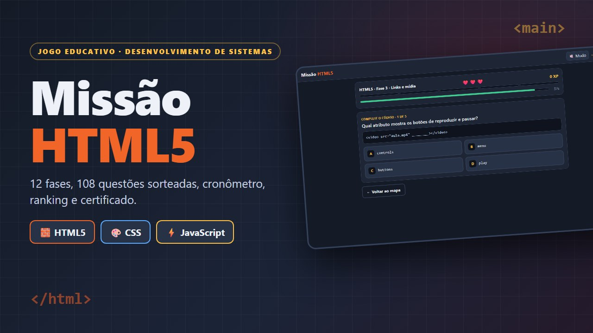
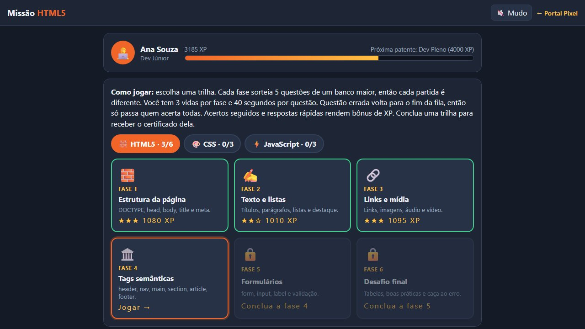
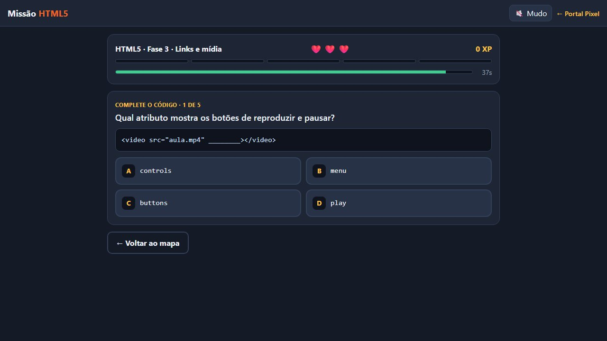
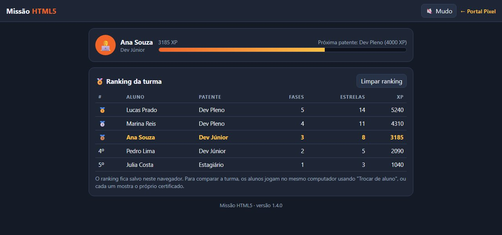
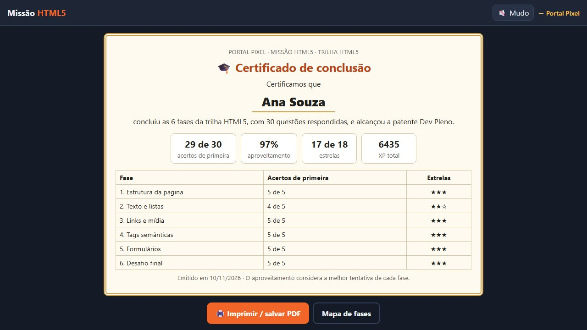
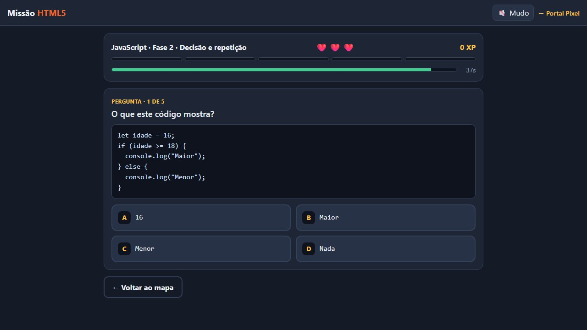
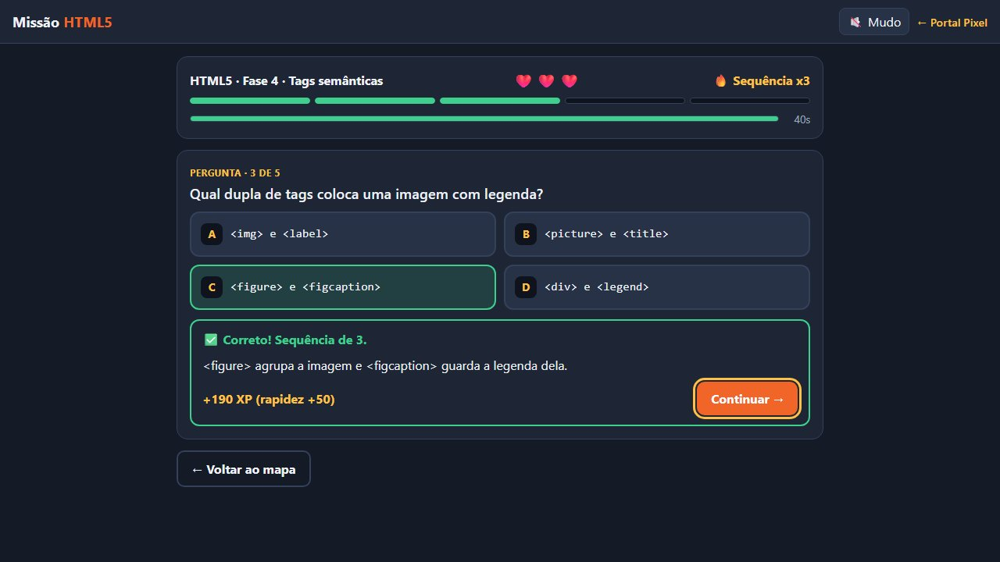
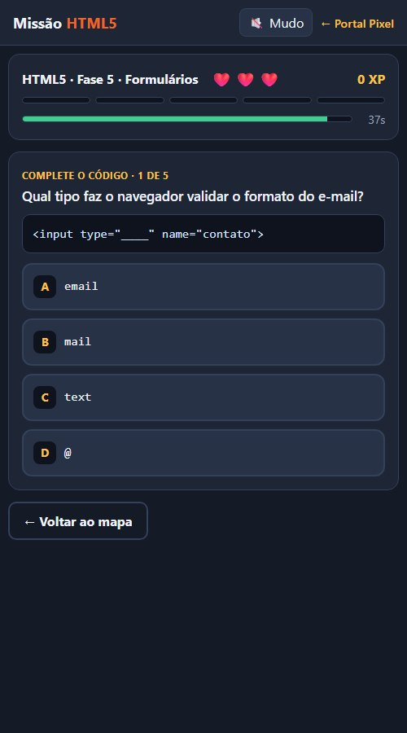

# Missão HTML5 — Documento de Design do Jogo (GDD)

Versão do jogo: **1.4.0** · Atualizado em 10/11/2026 · Autor: Prof. Heberson Miliano

Este documento descreve o jogo Missão HTML5: para quem ele é, como funciona, o que ensina, como foi construído e como evoluir. Ele acompanha o jogo publicado no Portal Pixel e deve ser atualizado a cada versão.

## Visão geral

| Item | Descrição |
|---|---|
| Título | Missão HTML5 |
| Gênero | Educativo, jogo de perguntas (quiz) com progressão por fases |
| Plataforma | Navegador, no computador e no celular |
| Público | Alunos do curso técnico em Desenvolvimento de Sistemas |
| Jogadores | 1 por vez; vários alunos podem se revezar no mesmo computador |
| Duração | Cerca de 3 a 5 minutos por fase |
| Tecnologia | HTML5, CSS e JavaScript puros, em um único arquivo, sem bibliotecas |
| Endereço | `jogo.html?id=missao-html5` no Portal Pixel |
| Código | `jogos/missao-html5/index.html` no repositório `portal-jogos` |

**Resumo em uma frase:** o aluno avança por 12 fases de HTML5, CSS e JavaScript respondendo questões sorteadas, com vidas, cronômetro, XP, patentes, ranking e certificado.

## Objetivos pedagógicos

1. Revisar o conteúdo de front-end do curso: marcação com HTML5, estilo com CSS e lógica com JavaScript.
2. Treinar a leitura de código, com questões de completar o código, achar o erro e prever o resultado.
3. Corrigir o erro no momento em que ele acontece: toda resposta, certa ou errada, mostra uma explicação curta.
4. Garantir que o aluno veja todo o conteúdo da fase: a questão errada volta para o fim da fila e a fase só termina quando todas forem acertadas.
5. Dar ao professor um registro simples do desempenho: o certificado mostra os acertos de primeira por fase e o aproveitamento.

## Público e uso em sala

- **Revisão antes da prova:** cada aluno joga a trilha do conteúdo estudado e mostra o certificado.
- **Competição no laboratório:** os alunos se revezam no mesmo computador com o botão Trocar de aluno, e o ranking mostra a classificação.
- **Atividade para casa:** o jogo funciona no celular e guarda o progresso no navegador do aluno.
- **Alunos que leem mais devagar:** o professor pode desligar o cronômetro no mapa de fases. Sem cronômetro não há bônus de rapidez, e o restante do jogo é igual.

## Ciclo de jogo

1. O aluno digita o nome. Sem nome, as fases ficam bloqueadas.
2. No mapa, escolhe a trilha (HTML5, CSS ou JavaScript) e a fase liberada.
3. A fase sorteia 5 questões do banco e embaralha as alternativas.
4. O aluno responde. A tela mostra a alternativa certa e a explicação.
5. Acerto: ganha XP e a questão sai da fila. Erro ou tempo esgotado: perde uma vida e a questão volta para o fim da fila.
6. Fila vazia: fase concluída, com estrelas, XP e a próxima fase liberada. Sem vidas: a fase recomeça com um novo sorteio.
7. Trilha concluída: o certificado da trilha fica disponível.

## Mecânicas

### Vidas e fila de questões

Cada fase começa com 3 vidas. Um erro, ou o fim do tempo, tira uma vida e manda a questão para o fim da fila. Com isso o aluno pode errar até 2 vezes por fase; no terceiro erro a fase termina e pode ser repetida.

### Sorteio

Cada fase tem um banco de 8 a 10 questões e sorteia 5 por partida. A ordem das questões e das alternativas muda a cada vez. Isso dificulta decorar a posição das respostas e copiar do colega ao lado.

### Cronômetro

Cada questão tem 40 segundos. Uma barra mostra o tempo, fica vermelha nos últimos 10 segundos e emite um som nos últimos 5. O cronômetro é ligado por padrão e pode ser desligado no mapa de fases.

### Pontuação (XP)

| Origem | XP |
|---|---|
| Acerto | 100 |
| Sequência de acertos | +20 para cada acerto seguido anterior, até +100 |
| Rapidez (com cronômetro) | até +50, proporcional ao tempo que sobrou |
| Vidas restantes ao concluir a fase | +50 por vida |

O máximo por fase é 1.100 XP com cronômetro e 850 XP sem. O jogo guarda o melhor resultado de cada fase, então repetir uma fase só aumenta o XP quando o aluno supera o próprio recorde.

### Estrelas

| Acertos de primeira na fase | Estrelas |
|---|---|
| 5 de 5 | 3 |
| 4 de 5 | 2 |
| 3 ou menos | 1 |

### Patentes

O XP somado das três trilhas define a patente do aluno.

| Patente | XP necessário |
|---|---|
| Estagiário | 0 |
| Dev Júnior | 1.500 |
| Dev Pleno | 4.000 |
| Dev Sênior | 7.000 |
| Arquiteto Web | 10.000 |

Concluir só a trilha de HTML5 leva até Dev Pleno. Para chegar a Arquiteto Web é preciso jogar bem as três trilhas.

### Ranking da turma

Ao concluir uma fase, o aluno entra no ranking, que mostra os 10 melhores por XP, com patente, fases concluídas e estrelas. O botão Trocar de aluno apaga o progresso do aluno atual e mantém a pontuação dele no ranking. O botão Limpar ranking zera a tabela.

O ranking fica salvo no navegador. Ele reúne os alunos que jogaram no mesmo computador, não a turma inteira em computadores diferentes.

### Certificado

Cada trilha concluída libera um certificado com o nome do aluno, a patente, os acertos de primeira por fase, o aproveitamento e a data. O botão Imprimir abre a impressão do navegador, que também salva em PDF. O aproveitamento considera a melhor tentativa de cada fase.

## Conteúdo

### Trilhas e fases

| Trilha | Fase | Conteúdo | Banco |
|---|---|---|---|
| HTML5 | 1. Estrutura da página | DOCTYPE, html, head, body, title, meta charset, viewport, lang | 10 |
| HTML5 | 2. Texto e listas | Títulos, parágrafo, br, hr, ul, ol, li, strong, em | 10 |
| HTML5 | 3. Links e mídia | a, href, target, img, src, alt, audio, video, caminho relativo | 10 |
| HTML5 | 4. Tags semânticas | header, nav, main, section, article, aside, footer, figure | 10 |
| HTML5 | 5. Formulários | form, input e seus tipos, label, required, placeholder, select, textarea | 10 |
| HTML5 | 6. Desafio final | Tabelas, link de CSS, script, comentário, aninhamento, caça ao erro | 10 |
| CSS | 1. Seletores e sintaxe | Regra, seletor de tag, classe e id, color, background-color | 8 |
| CSS | 2. Texto e modelo de caixa | font-size, font-weight, text-align, padding, border, margin | 8 |
| CSS | 3. Layout e responsivo | Flexbox, grid, media query, rem, :hover, especificidade | 8 |
| JavaScript | 1. Variáveis e tipos | let, const, string, number, boolean, console.log | 8 |
| JavaScript | 2. Decisão e repetição | if e else, operadores de comparação e lógicos, for, while | 8 |
| JavaScript | 3. Funções, listas e página | function, return, arrays, getElementById, eventos | 8 |

Total: 3 trilhas, 12 fases e 108 questões.

### Tipos de questão

- **Pergunta:** conceito direto, com quatro alternativas.
- **Complete o código:** um trecho com uma lacuna.
- **Ache o erro:** um trecho com um erro para identificar.
- **O que este código mostra?:** leitura de código, na trilha de JavaScript.

### Regras de escrita das questões

1. Uma única alternativa certa e três erradas plausíveis.
2. Enunciado curto, com uma ideia só.
3. A explicação diz por que a resposta está certa e, quando ajuda, desfaz a confusão mais comum.
4. Código de exemplo com no máximo 6 linhas.

## Telas

| Tela | O que mostra |
|---|---|
| Mapa | Perfil com patente e barra de XP, abas das trilhas, fases, cronômetro, ranking |
| Partida | Fase, vidas, sequência, progresso, tempo, pergunta, código, alternativas, explicação |
| Resultado da fase | Estrelas, acertos de primeira, bônus de vidas, XP e recorde |
| Certificado | Nome, patente, aproveitamento e tabela por fase |

No celular, as alternativas ficam em uma coluna e o mapa em duas.

## Controles

| Ação | Mouse ou toque | Teclado |
|---|---|---|
| Responder | Clicar na alternativa | A, B, C, D ou 1, 2, 3, 4 |
| Continuar | Botão Continuar | Enter |
| Sair da fase | Botão Voltar ao mapa | Tab até o botão e Enter |

## Áudio

Os sons são gerados no navegador com a Web Audio API, sem arquivos: acerto (mais agudo conforme a sequência), erro, aviso dos últimos 5 segundos, fase concluída e derrota. O botão Som no topo liga e desliga, e a escolha fica salva.

## Acessibilidade

- Todos os botões funcionam por teclado e têm foco visível.
- Acerto e erro usam cor, ícone e texto, não só a cor.
- O resultado de cada resposta é anunciado para leitores de tela.
- Quem ativou a redução de movimento no sistema não vê o confete nem as animações.
- O cronômetro pode ser desligado.

## Arquitetura técnica

O jogo é um arquivo único, `jogos/missao-html5/index.html`, com HTML, CSS e JavaScript. Não usa bibliotecas, imagens nem servidor.

### Formato de uma questão

    { tipo: "Complete o código",          // opcional; o padrão é "Pergunta"
      t: "Qual atributo informa o destino do link?",
      cod: "<a ____=\"https://www.exemplo.com\">Visitar</a>",   // opcional
      mono: true,                          // alternativas em fonte de código
      op: ["src", "link", "href", "url"],
      c: 2,                                // posição da alternativa certa, a partir de 0
      e: "No <a>, o atributo href guarda o endereço de destino." }

### Como ampliar o conteúdo

- **Nova questão:** acrescente um objeto na lista `q` da fase. O sorteio já passa a incluí-la.
- **Nova fase:** acrescente `{ icone, titulo, desc, q: [...] }` na lista da trilha, com pelo menos 5 questões.
- **Nova trilha:** crie a lista de fases e acrescente `{ id, nome, icone, fases }` em `TRILHAS`.

Os textos entram na página como texto puro, então tags como `
` aparecem escritas e não são interpretadas.

### Constantes de ajuste

| Constante | Valor | Significado |
|---|---|---|
| `POR_FASE` | 5 | Questões sorteadas por fase |
| `VIDAS` | 3 | Vidas por fase |
| `TEMPO` | 40 | Segundos por questão |
| `XP_ACERTO` | 100 | XP por acerto |
| `XP_COMBO` | 20 | XP por acerto seguido anterior, até 5 |
| `XP_TEMPO` | 50 | XP máximo de rapidez |
| `XP_VIDA` | 50 | XP por vida restante |

### Dados salvos

Tudo fica no `localStorage` do navegador. Nada é enviado para a internet.

| Chave | Conteúdo |
|---|---|
| `portalpixel.missao-html5.v1` | Nome, melhor resultado de cada fase, trilha aberta, som e cronômetro |
| `portalpixel.missao-html5.ranking` | Até 50 alunos com nome, XP, estrelas, fases e data |

O progresso da versão 1.0, que só tinha HTML5, é convertido ao abrir o jogo.

## Integração com o Portal Pixel

| Arquivo | Papel |
|---|---|
| `jogos.js` | Entrada do catálogo: textos, versão, capa, guia e o histórico em `novidades` |
| `assets/missao-html5.js` e `.css` | Apresentação com capturas, trilhas e atualizações |
| `assets/missao-html5/` | Capa e capturas reais do jogo |
| `guias/missao-html5.md` | Este documento, a fonte da página `guias/missao-html5.html` |
| `j/missao-html5/` e `previas/missao-html5.jpg` | Link curto e imagem para compartilhar |

Para publicar uma versão nova: altere o jogo, aumente `VERSAO` no jogo e `versao` no catálogo, acrescente a versão no início de `novidades`, atualize este documento e gere a página do guia de novo.

## Testes realizados na versão 1.4.0

- Partida automática completa nas 12 fases, conferindo que cada questão sorteada tem 4 alternativas e exatamente 1 certa.
- Derrota por falta de vidas e nova tentativa.
- Fim do tempo contando como erro.
- Cronômetro desligado: sem barra e sem bônus de rapidez.
- Conversão do progresso salvo pela versão 1.0.
- Ranking com dois alunos e Trocar de aluno.
- Certificado das três trilhas.
- Página do jogo e vitrine da página inicial no portal.

Ainda não testado: uso em um celular físico e impressão do certificado em papel.

## Histórico de versões

| Versão | Data | Mudanças |
|---|---|---|
| 1.4 | 10/11/2026 | Trilhas de CSS e JavaScript, abas, um certificado por trilha, patentes recalculadas |
| 1.3 | 10/11/2026 | Ranking da turma e botão Trocar de aluno |
| 1.2 | 10/11/2026 | Banco de HTML5 com 10 questões por fase e sorteio de 5 |
| 1.1 | 10/11/2026 | Cronômetro de 40 segundos com bônus de rapidez, que pode ser desligado |
| 1.0 | 10/11/2026 | Lançamento: 6 fases e 30 questões de HTML5, vidas, sequência, XP, patentes e certificado |

## Limitações e próximos passos

- **Ranking entre computadores:** o ranking é local. Um ranking da turma inteira exige um serviço externo para guardar as pontuações, com conta e regras de privacidade para dados de alunos.
- **Banco de CSS e JavaScript:** as fases têm 8 questões; a meta é chegar a 10, como em HTML5.
- **Relatório para o professor:** exportar os resultados do ranking em uma planilha.
- **Novas trilhas:** lógica de programação, banco de dados e Git seguem o mesmo formato.
